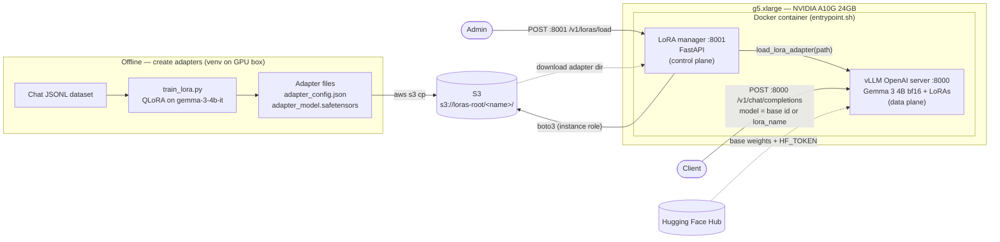

# Architecture

A two-part platform: an **offline training path** that creates LoRA adapters and
an **online serving path** that hosts a base Gemma 3 model and attaches adapters
at inference time. **S3** is the handoff between them.

## Legend / flow

- **Offline:** your chat-format JSONL → `train_lora.py` (4-bit QLoRA, rank-32 on
  the language layers) → PEFT adapter files → uploaded to S3.
- **S3 (`s3://loras-root/<name>/`):** durable source of truth; one folder per adapter.
- **vLLM `:8000` (data plane):** loads Gemma 3 4B once; serves the OpenAI API.
  A request selects weights via the `model` field (base id or a loaded `lora_name`).
- **LoRA manager `:8001` (control plane):** on a load request, pulls the adapter
  from S3 to local disk (boto3 / EC2 instance role), then calls vLLM's runtime
  `load_lora_adapter` with the local path — bridging S3 to vLLM's local-path-only API.
- **Hugging Face Hub:** source of the gated base weights at startup (needs `HF_TOKEN`).

## Notes

- Solid arrows = request/data flow; dashed = pull-from-remote.
- Both ports are unauthenticated on their own — front them with an ALB/auth proxy
  or keep them private (the `:8001` control plane especially).
- Loaded-adapter set is in-memory vLLM state (cleared on restart); S3 is durable.
